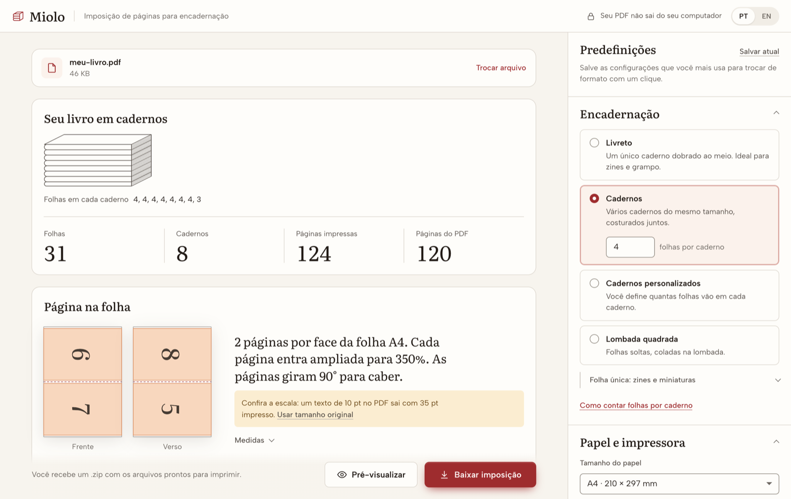

<h1>
  <picture>
    <source media="(prefers-color-scheme: dark)" srcset="docs/img/logo-escuro.png">
    
  </picture>
</h1>

**Imposição de páginas para encadernação artesanal.**
Envie um PDF, escolha o formato e baixe as folhas prontas para imprimir, dobrar e costurar.

[](https://luizfelipermoraes.github.io/miolo/)
[](https://github.com/luizfelipermoraes/miolo/releases/latest/download/Miolo.dmg)

[](https://github.com/luizfelipermoraes/miolo/releases/latest)
[](LICENSE)
[](https://github.com/luizfelipermoraes/miolo/actions/workflows/test.yml)

<picture>
  <source media="(prefers-color-scheme: dark)" srcset="docs/img/miolo-escuro.png">
  
</picture>

[English](#english) · [Recursos](#recursos) · [Instalar no Mac](#instalar-no-mac) · [Desenvolvimento](#desenvolvimento) · [Contribuir](CONTRIBUTING.md)

## Por que o Miolo

Miolo é o bloco de páginas do livro antes da capa. Para chegar nele, as páginas do PDF precisam ser reordenadas e giradas de modo que, depois de impressas frente e verso e dobradas, saiam na sequência certa. Esse processo se chama imposição. O Miolo faz a conta e mostra o resultado antes de você gastar papel.

- **Privado:** tudo roda no seu computador. O PDF não é enviado a nenhum servidor.
- **Sem instalação:** funciona no navegador. Para quem prefere, há um app nativo para Mac.
- **Em português e inglês**, com termos do ofício: caderno, fólio, lombada, folha de guarda.

## Recursos

- **Formatos de encadernação:** livreto (um caderno só), cadernos do mesmo tamanho, cadernos com tamanhos à sua escolha e lombada quadrada (folhas soltas, coladas).
- **Folha única:** zine de 8 páginas, terços e miniaturas de 16 a 60 páginas por face.
- **Dobras:** fólio, quarto, oitavo e 16º (2, 4, 8 ou 16 páginas por face da folha).
- **Papel:** 57 tamanhos (séries A e B, JIS, formatos de livro, América do Norte, cartões) ou um tamanho personalizado, em mm, cm, polegadas ou pontos.
- **Impressão:** frente e verso num arquivo só, ou frentes e versos separados para impressoras de uma face.
- **Ajustes finos:** escala, posição, margens extras, rotação das páginas, intervalo de páginas e folhas de guarda.
- **Marcas:** dobra, corte, ordem dos cadernos, borda do PDF e furos para costura.
- **Conferência:** resumo do livro (folhas, cadernos, páginas), desenho da primeira folha com as páginas no lugar, aviso quando a escala muda o tamanho do texto e prévia do PDF.
- **Predefinições:** salve as configurações que mais usa. Elas também ficam no endereço da página, que pode ser guardado ou compartilhado.

## Instalar no Mac

1. Baixe o [**Miolo.dmg**](https://github.com/luizfelipermoraes/miolo/releases/latest/download/Miolo.dmg) (cerca de 2 MB).
2. Abra o arquivo e arraste o Miolo para a pasta Aplicativos.
3. Na primeira vez, o macOS avisa que não conseguiu verificar o app. Feche o aviso, abra **Ajustes do Sistema → Privacidade e Segurança** e clique em **Abrir Mesmo Assim**, ao lado do nome do Miolo.

O aviso aparece porque o app ainda não é assinado com um certificado de desenvolvedor da Apple. Isso só é preciso uma vez.

Funciona em Macs com Apple silicon e Intel, no macOS 12 ou mais novo. Em **Miolo → Ajustes** (⌘,) dá para escolher o idioma, o tema, onde salvar os arquivos e se eles abrem ao terminar.

## Desenvolvimento

Precisa do [Node.js](https://nodejs.org) 18 ou mais novo.

```bash
git clone https://github.com/luizfelipermoraes/miolo.git
cd miolo
npm install
npm run dev
```

O app abre em http://localhost:5173/miolo/ e recarrega sozinho a cada mudança.

| Comando             | O que faz                                            |
| ------------------- | ---------------------------------------------------- |
| `npm run dev`       | Servidor de desenvolvimento                          |
| `npm run build`     | Gera o site na pasta `dist`                          |
| `npm run preview`   | Serve a pasta `dist` em http://localhost:4173/miolo/ |
| `npm run test`      | Todos os testes, refeitos a cada mudança             |
| `npm run test:unit` | Só os testes rápidos, de `src`                       |
| `npm run test:pdf`  | Só os testes que comparam PDFs gerados, mais lentos  |
| `npm run lint`      | Confere o código com o ESLint                        |
| `npm run prettier`  | Confere a formatação com o Prettier                  |

### App para Mac

Precisa também das ferramentas de linha de comando do Xcode (`xcode-select --install`).

```bash
sh macos/build.sh   # gera macos/build/Miolo.app
sh macos/dmg.sh     # empacota em macos/build/Miolo.dmg
```

O app é uma janela nativa em Swift que carrega o mesmo app web, então toda correção no site chega também ao Mac. Para testar de ponta a ponta (enviar um PDF, gerar a imposição e baixar):

```bash
macos/build/Miolo.app/Contents/MacOS/Miolo --self-test "$PWD/docs/example_page_numbers.pdf"
```

### Estrutura

```
index.html     página principal do app web
src/           imposição (book.js, signatures.js), interface (html/), traduções (locales/)
public/        ícones e imagens servidos como estão
macos/         app nativo para Mac, em Swift, e o empacotamento em .dmg
docs/          PDFs de exemplo para conferir as imposições
pdf-test/      testes que comparam os PDFs gerados com versões de referência
```

Na pasta [`docs`](docs) há PDFs para testar. O [`example_page_numbers.pdf`](docs/example_page_numbers.pdf) tem os números de 1 a 120 em tamanho grande e ajuda a conferir a ordem das páginas.

## Contribuir

Correções, traduções e novos formatos são bem-vindos. Veja como preparar o ambiente, testar e abrir um pull request no [guia de contribuição](CONTRIBUTING.md). Para relatar um problema, abra uma [issue](https://github.com/luizfelipermoraes/miolo/issues) com o PDF (ou as medidas dele) e as configurações usadas.

## Créditos

O Miolo é um fork do [bookbinder-js](https://github.com/momijizukamori/bookbinder-js), de momijizukamori e [colaboradores](https://github.com/momijizukamori/bookbinder-js/graphs/contributors), que reescreveu o [Bookbinder](http://quantumelephant.co.uk/bookbinder/bookbinder.html) original sobre a biblioteca [pdf-lib](https://pdf-lib.js.org). A lógica de imposição vem desse trabalho. O fork redesenhou a interface, adicionou o português, o app para Mac e as ferramentas de conferência.

## Licença

[Mozilla Public License 2.0](LICENSE), a mesma do projeto original. Você pode usar, modificar e distribuir o Miolo, inclusive em projetos comerciais. Ao distribuir, os arquivos do Miolo que você modificou continuam sob a MPL e o código-fonte deles precisa ficar disponível.

O nome e a marca Miolo são só deste fork. O Miolo não é a versão oficial do Bookbinder nem do bookbinder-js.

---

## English

Miolo imposes PDF pages for hand bookbinding: upload a PDF, pick a format and download sheets ready to print, fold and sew. Everything runs on your computer and the PDF is never uploaded. The interface is available in Portuguese and English.

- **Use it in the browser:** [luizfelipermoraes.github.io/miolo](https://luizfelipermoraes.github.io/miolo/)
- **Download for Mac:** [Miolo.dmg](https://github.com/luizfelipermoraes/miolo/releases/latest/download/Miolo.dmg). Drag it to Applications. The first time, macOS can't verify the app: open **System Settings → Privacy & Security** and click **Open Anyway**. Apple silicon and Intel, macOS 12 or later.

Formats include booklets, signatures of equal or custom sizes, perfect binding and single-sheet zines, folded as folio, quarto, octavo or sextodecimo, on 57 paper sizes or a custom one. Miolo is a fork of [bookbinder-js](https://github.com/momijizukamori/bookbinder-js), licensed under the [MPL 2.0](LICENSE). See the [contributing guide](CONTRIBUTING.md) to get involved.
